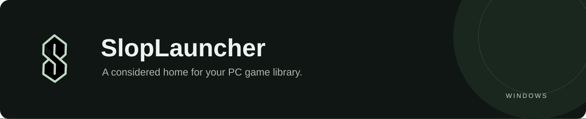
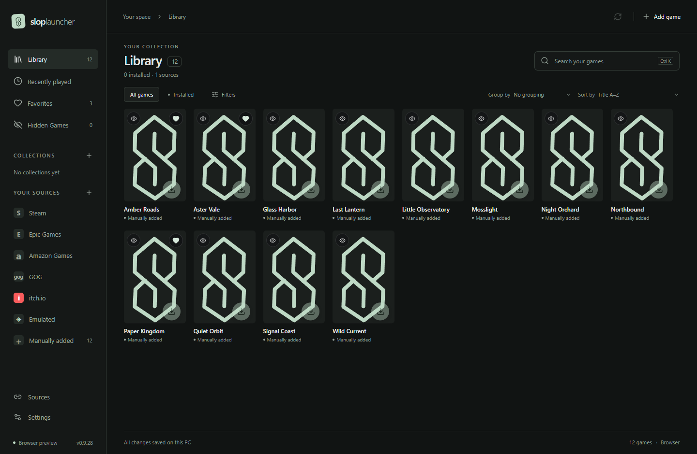

<p align="center">
  
</p>

<p align="center">
  
  
  <a href="LICENSE"></a>
  
  
  
</p>
<p align="center">
  <a href="#getting-started">Get started</a> · <a href="#a-library-that-fits-you">Features</a> · <a href="docs/GETTING-STARTED.md">Setup guide</a> · <a href="https://github.com/Clappingfetus/SlopLauncher/issues">Report an issue</a>
</p>

SlopLauncher brings your owned games, installed games, and manually added titles into a compact Windows desktop library. Browse covers, open rich game details, organize a backlog, and launch the version you want.

Built around responsive navigation, local persistence, and a quiet interface. **Early development:** expect rough edges and changing third-party integrations. There is no signed installer or automatic updater yet.


*Actual application UI with fictional sample games and original placeholder covers. No account data, scraped metadata, or downloaded game artwork is included in this repository.*

## Yes, it is entirely vibe coded

**100% vibe coded with Codex.** The development process involves describing an unreasonable number of launcher features, saying “make it faster,” and discovering that there is, in fact, another edge case.

The name is SlopLauncher. We felt disclosure was already fairly prominent.

We vibe coded a better launcher than Epic. lol

Underneath the vibes are actual tests, a Rust backend, and an ongoing campaign against duplicate games. Bugs are welcome in the issue tracker; they have already made themselves welcome in development.

*Built to organize the games we will definitely play right after we finish organizing them.*

## A library that fits you

| Browse & play | Organize & discover |
| --- | --- |
| Full owned libraries from five PC stores | Manual Collections and rule-based live Collections |
| Multiple installation folders per source | Smart Collections combining tags, size, dates, playtime, and ratings |
| Store versions together, with a saved preferred copy | Favorites and hidden status shared across matching duplicates |
| Manual games and reusable emulator profiles | HowLongToBeat **Main + Extras** sorting |
| Game details, artwork controls, and contextual actions | Consensus ratings, score ranges, and automatic rating groups |
| Compact covers, themes, and keyboard search | A dedicated Hidden Games view with duplicate grouping |

### Your sources, together

**Steam · Epic Games · GOG · Amazon Games · itch.io**

Connect accounts for owned libraries, scan supported local installations, or add games manually. Install and launch actions use available store-client handoffs; this is not a replacement download engine. Store clients may still be required. Unofficial store protocols can change.

Emulated games use configurable profiles for RetroArch and other emulators, including PlayStation, Switch, GameCube, and Wii U systems. Supply your own emulator and game files; platform support in the launcher does not guarantee compatibility in an emulator.

### Details worth opening

- **Metadata & artwork:** optional IGDB and SteamGridDB integrations. **ScreenScraper integration is planned but not implemented yet.** Native store covers take priority; SteamGridDB fills gaps by default for PC games. Choose alternate covers or backgrounds per game.
- **Useful links:** PCGamingWiki, HowLongToBeat, relevant store/community pages, and verified Nexus Mods entries live in game details.
- **Ratings:** Steam, GOG, Metacritic, and itch.io user ratings alongside OpenCritic critic scores, when available. The consensus weights the user category **60%** and critics **40%**; when only one category exists, it supplies the score. Sorting uses the precise score; stars display in half-star increments.
- **Achievements:** Steam achievement progress and explicitly linked RetroAchievements profiles. Your emulator earns RetroAchievements; SlopLauncher displays progress.

Home opens by default with horizontally scrolling shelves for activity, recent games, release dates, HLTB Main + Extras times, and each collection. Drag shelf titles to save a custom order.

Library filters include sources and tags. Select multiple games with the selection controls, Ctrl-click, or Shift-click to update favorites, hidden status, collections, or banish them together. Banished games stay blocked from imports and scans; restore them from **Settings → Banished games** to fetch fresh metadata and artwork. Installed game files and personal notes are kept.

External data is cached and refreshed through a bounded background queue. New games and identity changes are handled dynamically; failed providers leave the library usable. Data coverage and matching quality vary by service.

## Getting started

Download the [Windows x64 executable](https://github.com/Clappingfetus/SlopLauncher/releases/tag/v0.9.28) from the latest public prerelease. It requires Microsoft Edge WebView2 Runtime and is unsigned; see the release notes and checksum before running it.

Prefer to build from source? You will need:

- Windows with Microsoft Edge WebView2 Runtime
- Node.js **22.12+** and npm
- Rust stable with the MSVC toolchain
- Visual Studio Build Tools with **Desktop development with C++** and a Windows SDK

```powershell
git clone https://github.com/Clappingfetus/SlopLauncher.git
cd SlopLauncher
npm ci
npm run desktop
```

Create an optimized executable:

```powershell
npm run desktop:build
```

The executable is written to `src-tauri/target/release/sloplauncher.exe`. On first launch, open **Sources** or the optional **Setup wizard**, connect only the services you want, then configure metadata providers in **Settings**. [Read the setup guide →](docs/GETTING-STARTED.md)

<details>
<summary><strong>Development commands</strong></summary>

```powershell
npm run dev           # Browser UI preview with fictional sample data
npm run check         # Svelte and TypeScript checks
npm test              # Frontend regression tests
cargo test --manifest-path src-tauri/Cargo.toml
npm run desktop       # Native development app
npm run desktop:build # Optimized Windows executable
```

The desktop wrapper also supports an optional project-local Rust toolchain under `.tools/`. A browser preview cannot access native account credentials, scan disks, or launch desktop games.

</details>

## Local data & privacy

Your library lives locally in `%APPDATA%/com.sloplauncher.desktop`. Credentials are stored through the native Windows DPAPI-protected boundary, not browser local storage. Optional online integrations contact their respective services.

**This repository contains no personal API keys, access tokens, account databases, scraped metadata, or downloaded box art.** Each user supplies their own connections. Shared public Epic/GOG OAuth client constants are part of the protocol adapters; they do not grant access to an account.

See [security and publication boundaries](SECURITY.md). Do not attach database files, tokens, or unredacted logs to issues.

## Project status

Current source: **0.9.58**. Smart Collections now has a dedicated action next to Filters. Start with an empty collection, combine ALL/ANY rules, preview matches, and save directly to the sidebar. Collections update with new games and metadata, can overlap, and can be edited later. Older saved smart rules remain available to reuse. Full release dates are retained from stores when available, with platform-specific IGDB dates as a fallback. Recently Released and release sorting use the full date, and details show the calendar day. Year-only dates stay year-only. Existing games with missing dates can be filled using the Metadata refresh button; this does not trigger a new startup scan. Cover paths, resolved fallbacks, and failed-download retry deadlines now persist in SQLite. Restarts restore the cover index directly; new and invalidated entries are prepared as needed.

Metadata gets one automatic lookup pass for newly discovered or rematched games. Existing libraries stay quiet on restart. Use the circular refresh button beside Metadata in the bottom bar to check games with gaps manually, including when automatic lookup is disabled. Startup warms the first screen from cached thumbnails before showing cards; remaining cached paths load in bounded batches without waiting for network downloads.

Steam activity imports last-played dates, lifetime hours, and two-week playtime using your connected account. SlopLauncher keeps separate local launch dates and counts; Recently Played can show either history or both. Automatic history refresh runs every 15 minutes while background sync is enabled, with a manual refresh in Sources. Steam game-details privacy can limit the data returned. Local counts record successful launch requests, not measured session durations.

Recent work includes consensus rating groups, cross-store personal flags, Amazon portrait artwork handling, and duplicate grouping in Hidden Games.

Next priorities include testing on clean Windows installations, more robust store integrations, and signed distribution. Performance is a design priority, not a hardware-independent benchmark claim.

Bug reports are welcome: include the app version, Windows version, affected source, and steps to reproduce. [Contribution notes →](CONTRIBUTING.md)

---

Built with **Tauri 2 · Rust · Svelte 5 · TypeScript · SQLite**. Independent project; not affiliated with the stores or metadata services listed above. Third-party names belong to their respective owners.

Licensed under the [MIT License](LICENSE).
